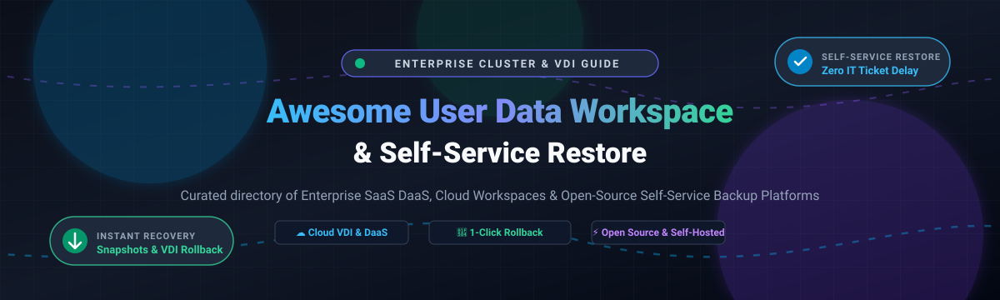

  

# 🚀 Awesome User Data Workspace & Self-Service Restore  

> 🌐 **A comprehensive, SEO-optimized directory of top User Data Workspace and Self-Service Restore solutions.** Compare enterprise SaaS virtual desktop infrastructure (VDI), Desktop-as-a-Service (DaaS), cloud workspaces, endpoint protection, and open-source self-service backup platforms with instant end-user snapshot rollbacks and zero-ticket recovery.
>
> 🌟 **Star this repository on GitHub** if you find it valuable for your architecture planning and infrastructure deployments!

---

## 📑 Table of Contents

- [🌐 Sector Overview & Market Dynamics](#-sector-overview--market-dynamics)
- [🏢 SaaS & Hosted Commercial Platforms](#-saas--hosted-commercial-platforms)
- [💻 Open-Source & Self-Hosted Software](#-open-source--self-hosted-software)
- [📊 Feature Comparison Matrix](#-feature-comparison-matrix)
- [🔍 Architectural Patterns & Best Practices](#-architectural-patterns--best-practices)
- [🤝 Contributing](#-contributing)
- [📄 License](#-license)

---

## 🌐 Sector Overview & Market Dynamics

The global market for Virtual Desktop Infrastructure (VDI), Desktop-as-a-Service (DaaS), and user data recovery was valued at approximately **$19.6 billion to $22.5 billion in 2024–2025** and is projected to surpass **$85 billion by 2032–2034**, expanding at a Compound Annual Growth Rate (CAGR) of **15% to 19%**.

The sector exhibits a **concentrated core alongside a fragmented operational ecosystem**:
- **Core Market Concentration:** Hyperscalers and enterprise virtualization giants (Microsoft Azure Virtual Desktop, Amazon Web Services WorkSpaces, Citrix Cloud Software Group, Omnissa Horizon Cloud, and Nutanix) control roughly **35%–40%** of aggregate market share, leveraging deep enterprise software bundling, identity systems, and unified cloud control planes.
- **Ecosystem Fragmentation:** The perimeter remains moderately fragmented across specialized third-party cloud-management vendors, endpoint backup specialists (such as Druva), and industry-specific compliance architectures (e.g., healthcare, financial BFSI, defense-grade zero-trust VDI), driving strong demand for independent, open-source, and self-hosted restore toolchains.

---

## 🏢 SaaS & Hosted Commercial Platforms

Below is the structured overview of leading commercial SaaS, DaaS, and endpoint platforms featuring user data protection, virtual desktops, and self-service restore capabilities.

*The table is sorted descending by company scale (Revenue / Valuation).*

| Platform | Company Valuation / Revenue | Pricing (Specific Starting Tier) | Free Tier Limits / Free Trial Details | Restore Mechanism | Primary Architecture & Recovery Scope |
| :--- | :--- | :--- | :--- | :--- | :--- |
| **[Azure Virtual Desktop (AVD)](https://azure.microsoft.com/products/virtual-desktop/) + [Nerdio](https://getnerdio.com/)** | **~$3.1 Trillion** market cap / **$245B+** rev (Microsoft) | **$6.00/user/month** (Nerdio Core AVD) + Azure compute; **$10.00/user/month** (Nerdio Premium for Self-Service Restore) *(minimum $1,000/month commitment)* | **30-day free trial** of Nerdio Manager for Enterprise via Azure Marketplace + Microsoft Azure $200 credits (first 30 days) | 🔄 **End-User & Admin Self-Restore** | Enterprise cloud VDI on Azure with instant host pool backup rollbacks, user session resets, and desktop restoration via Nerdio Premium portal. |
| **[Amazon WorkSpaces](https://aws.amazon.com/workspaces/)** | **~$2.0 Trillion** market cap / **$105B+** AWS run-rate (Amazon) | **$7.25/month base fee + $0.22/hour** (Value Bundle AutoStop hourly) or **$21.00/user/month** (Fixed monthly Standard Linux/Windows bundle) | **Free for 3 billing cycles (90 days):** Up to 2 standard bundles (Ubuntu, Windows, or Linux) with 80 GB root + 50 GB user volumes running in AutoStop mode up to 40 hours/month combined | 🛠️ **Admin-Initiated Snapshot Rollback** | Fully managed enterprise cloud desktops. 12-hour automated snapshots allow admins to roll back root and user volumes to last known healthy state. |
| **[VMware Horizon Cloud](https://www.omnissa.com/horizon/) (Omnissa)** | **~$4.0 Billion** valuation (KKR-acquired Broadcom spin-off) | **$4.67/user/month** (Horizon Apps Standard) or **$9.00/user/month** (Horizon Cloud on Microsoft Azure Standard control plane) | **30-day proof-of-concept trial** provisioned via Azure Marketplace / AWS Marketplace or Omnissa sales partner with access to full control plane and image test pools | 🔄 **User Desktop Reset & Admin Restore** | Multi-cloud enterprise VDI and DaaS. Users can trigger dedicated desktop resets from Workspace ONE portal when frozen or degraded. |
| **[Nutanix Frame & NGT SSR](https://www.nutanix.com/)** | **~$15.0 Billion** market cap / **$2.15B** annual revenue | **~$330.00/core/year** (~$27.50/core/month amortized) for Nutanix Cloud Infrastructure (NCI) Pro tier (required for Self-Service Restore features) | **30-day free trial** of Nutanix Cloud Clusters (NC2 on AWS/Azure); non-production **Nutanix Community Edition (CE)** is free forever on lab hardware | 🔄 **End-User File-Level Restore** | Hyperconverged infrastructure VDI. Nutanix Guest Tools (NGT) Self-Service Restore allows users to browse snapshot disks via web GUI/`ngctl` and restore files directly. |
| **[Citrix Workspace](https://www.citrix.com/) (Cloud Software Group)** | **~$16.5 Billion** enterprise transaction / **$3.2B+** revenue | **$10.00/user/month** (Citrix DaaS Standard entry plan) or **$13.00/user/month** (Citrix DaaS Advanced Plus) | **7-day turnkey evaluation** for Citrix DaaS on Azure; 30-day custom enterprise PoC granted upon authorized partner or sales registration | 🔑 **Self-Service Password & Credential Reset** | Virtual app and desktop virtualization suite with unified self-service password reset (SSPR) and workspace recovery controls to minimize IT helpdesk tickets. |
| **[Druva Data Security Cloud](https://www.druva.com/)** | **~$2.0 Billion** valuation / **$250M+** ARR | **$6.00/user/month** (inSync Enterprise Endpoint) or **$8.50/user/month** (inSync Elite with advanced ransomware rollback) | **30-day free trial** with full access to endpoint protection suite, cloud portal, 100 GB pooled storage quota, and end-user self-service restore testing | 🔄 **100% End-User Initiated File & OS Restore** | Pure SaaS endpoint backup for Windows, macOS, Linux, and iOS. Users search file trees and restore missing or encrypted files to any target device without IT help. |
| **[Workspot Enterprise DaaS](https://www.workspot.com/)** | **~$250 Million** estimated private valuation | **$15.00/user/month** baseline software control tier or **$75.00/user/month** (inclusive of turnkey Azure/GCP cloud workstation compute and egress) | **No perpetual free tier;** 14-day to 30-day structured enterprise Proof of Concept (PoC) with managed cloud workstation instances upon sales verification | 🛠️ **IT Admin 1-Click Rollback** | Cloud-native multi-region DaaS on Azure and Google Cloud. One-click administrator restore rollbacks from daily, weekly, or monthly scheduled disaster snapshots. |

---

## 💻 Open-Source & Self-Hosted Software

The open-source ecosystem provides powerful, audit-proof, and cost-effective alternatives across VDI brokers, cloud developer workspaces, and snapshot backup web portals.

*The table is sorted descending by repository GitHub stars.*

| Repository | Stars | Technology Stack | License | Self-Service Restore Capability | Primary Use Case & Architecture |
| :--- | :---: | :--- | :--- | :--- | :--- |
| **[Nextcloud Server](https://github.com/nextcloud/server)** |  | PHP, JavaScript, Vue.js | AGPL-3.0 | 🔄 **File-Level User Restore** | Complete on-premise collaborative workspace. Built-in 30-day deleted files Trash Bin and granular file version history restoration with end-user self-recovery. |
| **[Restic](https://github.com/restic/restic)** |  | Go | BSD-2-Clause | 🔄 **CLI & FUSE Snapshot Mount** | Fast, secure, encrypted deduplicating backup engine. Users can mount backup repositories via FUSE to visually browse snapshots and restore individual files. |
| **[Coder](https://github.com/coder/coder)** |  | Go, TypeScript, Terraform | AGPL-3.0 | 🔄 **Workspace Rebuild & Volume Restore** | Self-hosted cloud development environments on Kubernetes or VMs. Developers provision, stop, and recreate workspaces from persistent volume snapshots with zero IT intervention. |
| **[Duplicati](https://github.com/duplicati/duplicati)** |  | C#, .NET, Web UI | LGPL-2.1 | 🔄 **Web UI End-User Restore** | Free backup client for desktop workspaces (Windows, macOS, Linux). Integrated local web management interface with step-by-step point-in-time file recovery wizard. |
| **[Kopia](https://github.com/kopia/kopia)** |  | Go, HTML/JS | Apache-2.0 | 🔄 **GUI Snapshot Browser & Restore** | Fast, end-to-end encrypted backup tool with both CLI and native Desktop GUI. Users can mount snapshots as virtual drives or restore directories directly from cloud storage targets. |
| **[BorgBackup (Borg)](https://github.com/borgbackup/borg)** |  | Python, C, Cython | BSD-3-Clause | 🔄 **FUSE Mount & Archive Extraction** | Deduplicating backup program supporting authenticated encryption. Snapshots can be mounted locally via FUSE, allowing users to drag and drop lost files back to workspace disks. |
| **[Backrest](https://github.com/garethgeorge/backrest)** |  | Go, TypeScript, Restic | GPL-3.0 | 🔄 **Web-Based Self-Service Restore UI** | Lightweight web UI and orchestrator built on top of Restic. Enables non-technical end-users to visually explore snapshots, view file diffs, and download recovered folders. |
| **[Eclipse Che](https://github.com/eclipse-che/che)** |  | Java, TypeScript, Kubernetes | EPL-2.0 | 🔄 **Self-Service Workspace Restore** | Kubernetes-native developer workspace server. Provides users with a dashboard to restore deleted or stopped workspaces and recover uncommitted code from snapshot archives. |
| **[KasmVNC](https://github.com/kasmtech/KasmVNC)** |  | C, C++, JavaScript | GPL-2.0 | 🌐 **Browser-Based Remote Desktop Streaming** | High-performance open-source VNC server with web-native HTML5 streaming. Provides isolated workspace UI delivery commonly deployed alongside snapshot volume stores. |
| **[Apache Guacamole Server](https://github.com/apache/guacamole-server)** |  | C | Apache-2.0 | 🌐 **Clientless Workspace Gateway** | HTML5 remote desktop gateway supporting RDP, VNC, and SSH. Frequently deployed as the unified workspace access portal in front of Proxmox or KVM self-restore clusters. |
| **[Bekane](https://gitlab.com/factorfx/bekane)** |  | Python, Django, Vue.js | AGPL-3.0 | 🔄 **Proxmox VDI Snapshot Restore** | Open-source VDI broker engineered specifically for Proxmox VE. Supports user workspace provisioning, instant snapshot creation, and fast reset of virtual desktop instances. |

---

## 📊 Feature Comparison Matrix

| Platform / Tool | Deployment Model | License Type | Self-Service Restore Level | Restore Granularity | Infrastructure Dependency |
| :--- | :--- | :--- | :--- | :--- | :--- |
| **Azure Virtual Desktop + Nerdio** | Cloud SaaS / DaaS | Commercial | 🟢 **User-Initiated** *(Nerdio)* | Full Desktop & User Volumes | Microsoft Azure Cloud |
| **Amazon WorkSpaces** | Cloud Managed DaaS | Commercial | 🟡 **Admin-Initiated** | Root & User Volumes (12h snapshots) | AWS Cloud Infrastructure |
| **VMware Horizon Cloud** | Hybrid / Cloud DaaS | Commercial | 🟢 **User-Initiated** *(Reset)* | VM Desktop State Reset | Omnissa Cloud / Azure / AWS |
| **Nutanix Frame & NGT SSR** | On-Prem / Cloud HCI | Commercial | 🟢 **User-Initiated** | File & Directory Snapshots | Nutanix AOS / AHV Clusters |
| **Citrix Workspace** | Hybrid / SaaS | Commercial | 🟡 **Self-Service Credentials** | Password & Account Unlock | Multi-Cloud / On-Prem |
| **Druva Data Security** | 100% Cloud SaaS | Commercial | 🟢 **User-Initiated** | Granular Files, Folders, & Disks | AWS Cloud Backend (Managed) |
| **Workspot DaaS** | Cloud DaaS | Commercial | 🟡 **Admin-Initiated** | Full Cloud Desktop Rollback | Azure / Google Cloud Platform |
| **Nextcloud** | Self-Hosted | AGPL-3.0 | 🟢 **User-Initiated** | Files, Trash Bin, Version History | Docker / Bare-metal LAMP |
| **Restic** | Self-Hosted / CLI | BSD-2-Clause | 🟢 **User-Initiated** | Files, Folders, FUSE Mounts | Local disk, S3, B2, Azure, SFTP |
| **Coder** | Self-Hosted | AGPL-3.0 | 🟢 **User-Initiated** | Container Volumes & Workspaces | Kubernetes / Docker / VMs |
| **Duplicati** | Self-Hosted / Desktop | LGPL-2.1 | 🟢 **User-Initiated** | Point-in-time File Recoveries | Desktop OS / Local Web UI |
| **Kopia** | Self-Hosted / GUI | Apache-2.0 | 🟢 **User-Initiated** | Encrypted Snapshot File Explorer | Cloud Object Storage / Local NAS |
| **BorgBackup** | Self-Hosted / CLI | BSD-3-Clause | 🟢 **User-Initiated** | FUSE Virtual Mount & File Extracts | Unix / Linux Filesystem |
| **Backrest** | Self-Hosted | GPL-3.0 | 🟢 **User-Initiated** | Web-based Snapshot File Browser | Lightweight binary / Docker |
| **Eclipse Che** | Self-Hosted | EPL-2.0 | 🟢 **User-Initiated** | Dev Workspaces & Uncommitted Code | Kubernetes / OpenShift |
| **Apache Guacamole** | Self-Hosted | Apache-2.0 | ⚪ *Access Gateway Only* | Remote Desktop Sessions (RDP/VNC) | Docker / Tomcat / guacd |
| **Bekane** | Self-Hosted | AGPL-3.0 | 🟢 **Admin & Lab User** | Proxmox VE VM Snapshots | Proxmox VE Virtualization |

---

## 🔍 Architectural Patterns & Best Practices

1. **Separation of Ephemeral Compute and Persistent Data:**  
   In modern cloud workspace design (such as AWS WorkSpaces or Coder on Kubernetes), decouple the base OS operating image from user state. Store `/home/user` or `C:\Users\username` on isolated virtual disks or network storage backends so that restoring user data does not require repaving the entire virtual desktop image.

2. **Self-Service Restore via Read-Only Snapshot Mounts:**  
   Tools like **Restic**, **Kopia**, and **Nutanix SSR** avoid destructive overwrites by exposing snapshots as read-only virtual filesystems (via FUSE or shadow volumes). This empowers non-technical users to copy back accidentally modified or deleted files without risk of data loss.

3. **Multi-Region Disaster Recovery:**  
   Enterprise SaaS platforms like **Druva** and **Nerdio** maintain independent cloud-native metadata and payload stores across multiple availability zones, ensuring business continuity during regional cloud outages or ransomware incidents.

---

## 🤝 Contributing

Contributions to expand this curated list of user data workspace and self-service restore technologies are always welcome! 

When submitting a pull request, please adhere to the following standards:
- **Project URL & Summary:** Provide the official website or repository link with a concise description (1–2 sentences).
- **Stack & Open-Source License:** Specify backend runtime/language and official SPDX license identifier.
- **Self-Service Granularity:** Detail specifically whether restore capabilities are end-user initiated, file-level, or administrator-controlled.
- **Commit Format:** Use clear, standardized commit messages following [Conventional Commits](https://www.conventionalcommits.org/).

---

## 📄 License

This curated collection is released into the public domain under [CC0 1.0 Universal (Public Domain Dedication)](https://creativecommons.org/publicdomain/zero/1.0/). All individual software tools, project names, and logos belong to their respective copyright holders.

---

  ⭐ <b>Found this resource useful? Star the repository to stay updated with future revisions!</b> ⭐

